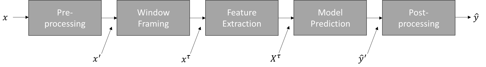

# PyDTS
Python Deep Timeseries Simulation (PyDTS) is a toolkit for capturing unknown and possibly non-linear relations between
input and output values. The current version includes statistical, machine learning, and deep-learning approaches for 
time-series modeling. The aim is to provide a better understanding of time-series modeling problems such as: forecasting,
denoising, non-linear SISO and MIMO modeling, degradation modeling, and anomaly detection. It is clear, that this toolkit
cannot be anywhere near the capabilities  of commercial software but will hopefully provide a better understanding due
to the freely available source code. The toolkit is not complete; thus, suggestions are always welcome.


# Publication and Citation
Please cite the following paper when using PyDTS for your work

Schirmer, P.A.; Mporas, I. PyDTS: A Python Toolkit for Deep Learning Time Series Modelling. Entropy 2024, 26, 311. https://doi.org/10.3390/e26040311

(https://www.mdpi.com/1099-4300/26/4/311)

Furthermore, please also cite the corresponding publicly available datasets.


# Dependencies
The requirements of the PyDTS toolkit are summarized in the requirements.txt data file. The current version is tested
with the following dependencies:
- Python 3.11
- PyTorch 2.1 (CUDA 12.1 build for GPU training)
- Optuna 4.4 (hyperparameter optimisation of the deep learning models)
- NeuralForecast 1.7 (short-term forecasting, SF)
- Scikit-Learn 1.5
- Numpy 1.24
- Pandas 2.2
- Scipy 1.13

requirements.txt pins the direct dependencies; requirements-lock.txt pins every package of a tested environment
(including the GUI) and reproduces it exactly:

```
python -m venv venv
venv\Scripts\python -m pip install -r requirements-lock.txt
```

The deep learning solvers (DL, CL, hyperparameter optimisation) use PyTorch; requirements.txt installs the CPU build.
For training on an NVIDIA GPU install the CUDA build and set `setupExp['gpu'] = 1`:

```
venv\Scripts\python -m pip install torch==2.1.2 --index-url https://download.pytorch.org/whl/cu121
```

Models are stored as `mdl/mdl_<model>_<name>/model.pt` (weights and model description) together with
`training_log.csv`. Versions up to 0.3 used TensorFlow/Keras (checkpoints `cp.ckpt`); these models cannot be loaded
anymore and must be retrained. The original implementation used Python 3.8 with Tensorflow 2.5 (req38.txt).

The data handling (split, normalisation, sequences, features) is checked by `python tests/test_core.py` (or
`python -m pytest tests`).

# Changes in Version 0.4
Version 0.4 changes the deep learning framework and corrects the data handling. Models trained with version 0.3 cannot
be loaded anymore, and its results are not comparable one to one with the results below; all pre-trained models under
\mdl and all results in this README have been recalculated with version 0.4.

| Area | Version 0.3 | Version 0.4 |
|------|-------------|-------------|
| Framework | TensorFlow/Keras, checkpoints `cp.ckpt` | PyTorch, `mdl/mdl_<model>_<name>/model.pt` + `training_log.csv`, GPU via `setupExp['gpu'] = 1` |
| Hyperparameter search (DL) | Keras-Tuner | Optuna (TPE sampler, Hyperband pruning), validated on held-out data |
| Validation data (methods 0, 1) | first share rV of the training data, also trained on | last share rV of the training data, not trained on |
| Validation data (method 3, IDs) | validation IDs (idV) stayed in training; idV = idT validated on the test set | every non-test ID is trained on; validation is the last share rV of each idV ID (of every training ID if idV is empty or contains only test IDs) |
| Shuffling | inputs and outputs shuffled independently (pairs broken) | one fixed permutation (seed 42) for inputs and outputs |
| z-score (inpNorm/outNorm = 3) | divided by the variance | divided by the standard deviation; constant channels no longer divide by zero |
| Stored model | every 5th epoch | epoch with the lowest validation loss |
| Resampling (fs ≠ data rate) | one time grid from the first to the last sample; gaps between IDs (e.g. removed test IDs) were filled with held values, and the step was not exactly 1/fs | every ID is resampled on its own grid with step 1/fs |
| Windows and lag (several IDs) | windows, the output lag and the closed-loop feedback ran across the boundary between two IDs | every ID is framed and shifted on its own; IDs shorter than one window are skipped with a warning |
| Random seed | fixed seed, but GPU kernels and shuffle order not reproducible | `setupExp['seed']` seeds weights, dropout and shuffle order; deterministic GPU kernels, the same seed gives the same model on the same machine |
| Seed ensemble | – | `setupExp['ensemble'] = N` trains N networks (seeds seed … seed+N-1, `model.pt`, `model_2.pt`, …); the test uses the mean prediction and prints every member, their mean ± standard deviation and the ensemble |
| Extrapolation check | – | the test warns for every input outside the range of the training data, with the share of samples per test ID |
| Resampling method | zero-order hold only | `setupDat['resample']`: 'hold' (default) or 'mean' (mean over each new sample interval, anti-aliasing when the rate is reduced) |
| Retraining ML models | an existing `.joblib` model was loaded and refitted with its old settings (changed parameters were ignored) | always a new fit with the current settings; SVM gamma 'scale' instead of 0.1 |
| Further fixes | | lag no longer wraps the series around, EWMA features restart per ID, output time/ID taken from the outputs, `SGD` optimiser selectable, balancing works, missing models/data stop with an error, closed-loop feedback uses the past output in training and testing |

Consequences for the results: the validation data no longer leak into training and the z-score is a true
standardisation, which removed a regularising effect of the old variance scaling. Some tutorials therefore score
lower than in version 0.3 (see Tutorial Results); Tutorial 2 now uses a learning rate of 3e-5 and Tutorial 3 takes its
validation data from the end of every training drive cycle (`idV = []`).

# Graphical User Interface
PyDTS has a local browser GUI (Streamlit) that edits all parameters of start.py and mdlPara.py, runs the toolkit
unchanged, and shows the predictions and errors as interactive charts, together with theory pages on temperature
prediction and neural networks. Install the GUI packages into the PyDTS environment and start it from the root
folder:

```
pip install -r gui/requirements.txt
python start_gui.py                      # opens http://localhost:8501
```

The user guide is docs/GUI.md (also shown in the GUI under Help › Documentation). After changing parameters in
start.py or mdlPara.py, run `python gui/build_config.py` to update the forms and the tutorial configurations.

# Datasets
The toolkit utilizes the following publicly available datasets, which have been pre-processed and reshaped for the users'
convenience and can be found under /data. The datasets have been clustered into one test dataset to show the working
principle of the toolkit and six tutorials covering different applications for time-series modeling. It should be noted
that all datasets are measured and no synthetic data has been used.

1) Tutorial 1 (Denoising) based on AMPDs2 dataset [1] (CC-BY 4.0): https://dataverse.harvard.edu/dataset.xhtml?persistentId=doi:10.7910/DVN/FIE0S4
2) Tutorial 2 (Forecasting) based on dataset [2]: https://www.kaggle.com/datasets/fedesoriano/electric-power-consumption
3) Tutorial 3 (Non-linear modeling) based on Electric Motor Temperature [3] (CC BY-SA 4.0): https://www.kaggle.com/datasets/wkirgsn/electric-motor-temperature
4) Tutorial 4 (Anomaly detection) based on Ford dataset [4]: https://www.timeseriesclassification.com/description.php?Dataset=FordA
5) Tutorial 5 (Degradation modeling) based on Battery aging [5] (CC BY 4.0): https://kilthub.cmu.edu/articles/dataset/eVTOL_Battery_Dataset/14226830/2
6) Tutorial 6 (Cross Domain modeling) based on vehicle data [6] (CC-BY 4.0): https://ieee-dataport.org/open-access/battery-and-heating-data-real-driving-cycles
7) Tutorial 7 (Short Term forecasting) based on energy generation data (example data)
8) Tutorial 8 (Closed Loop modeling) based on Electric Motor Temperature [3] (CC BY-SA 4.0): https://www.kaggle.com/datasets/wkirgsn/electric-motor-temperature

If the user wants to utilize their own datasets, data can be provided in '.csv', '.xlsx', and '.mat' formats at the moment.
Data templates can be found under \data.


# Limitations
Since the toolkit is still under development there are several things that need to be improved, are not yet implemented 
or lack verification. In the following a list of known issues and limitations is provided:
- The transfer functions are not yet reviewed and have shown inconsistent behavior
- There are minor issues for displaying and formatting units


# Architecture
The aim of the PyDTS toolkit is to model the input and output relation of an unknown system, namely $\hat{y}=f(X)$ where 
$X \in \mathbb{R}^{T \times M}$ is a feature input vector of $T$ time-steps and $M$ features and $y$ is a time-series output. A more
generalized architecture is illustrated below:



As can be seen, the general architecture consists of five steps namely pre-processing (e.g. resampling or filtering), window
framing, feature extraction, model prediction, and post-processing (e.g. limiting the output). The architecture is used
for all applications which are described below. Additionally, the different modules  offered by PyDTS and the flow diagram for the
different operations are illustrated below:


Overview of implemented modules and functionalities in the PyDTS toolkit. Inputs and
preprocessing are indicated in red, features and data sequencing in yellow, modelling in green,
postprocessing in blue, and visual elements and outputs in purple.


Internal data pipeline of PyDTS including training and testing modules and external data,
model, and setup databases.

## Applications
The toolkit aims to cover different applications as they usually appear in industrial settings for time-series modeling.
The following applications have been covered:

1) Denoising (Regression): $y(t)=\sum_{m} x_m(t) + \epsilon(t)$
2) Forecasting (Regression): $y(t) = \phi y(t − 1) + \beta x(t) + \epsilon(t)$
3) Non-linear modeling (Regression): $y(t)=f(x(t))$
4) Anomaly detection (Classification): $y(t)= \theta(f(x(t)))$
5) Degradation modeling (Regression): $y(t) = y_{0} + \beta x(t) + \epsilon(t)$

## Operating Modes
The toolkit offers three different operating modes. The operating modes can be controlled using 'setupExp['sim']' option
in the start.py file. The following three options are available. First, classical training and testing where a model is
trained using a training and validation dataset, and tested on a testing dataset respectively. Second, hyperparameters
optimization where free model parameters are optimally tuned using scikit GridSearchCV for machine learning models and
Optuna search (TPE sampler with Hyperband pruning) for deep learning models; the best model and all trials are
stored in mdl/mdl_opt_<model>_<name>/. Third, general parameters can be optimized using
a 2D grid search available in 'optiGrid.py'.

## Models
The toolkit as three different types of models implemented namely models based on Signal Processing (SP), e.g. State-Space (SS)
models or Transfer Function (TF) models, models based on Machine Learning (ML), e.g. Support Vector Machine (SVM) or Random
Forest (RF), models based on Deep Learning (DL), e.g. Long Short Term Memory (LSTM) or Convolutional Neural Network (CNN). Furthermore,
options for short-term time-series forecasting (SF) and closed loop (CL) modeling approaches are available. The input and
output relations (I/O) of the different models are illustrated in the figure below:


| SP/ML/DL                         | Short-Term Forecasting (SF)      | Closed Loop (CL)                 |
|----------------------------------|----------------------------------|----------------------------------|
|  | | |

where $X$ is an input time-series with $T$ samples and $F$ features, and $y$ is the output time-series with $T$ samples
and $L$ channels. Further, considering forecasting $W$ is the number of previous samples, while $H$ denotes the prediction
horizon. $X_{H}$ denotes historic time-series inputs, while $X_{F}$ denotes future value inputs.

# Exemplary Results
In the following chapter, a set of reference results is provided using the “default.txt” setup files provided in \setup. 
For a first test run use start.py to calculate the results presented below, which are already provided as pre-trained
models under \mdl. Therefore, training is disabled in start.py. The problem considered in the test example aims to model
the regenerative power ($MW$) of solar and wind generated in Germany. As input features standard weather data are available,
namely solar irradiance ($\frac{W}{m^2}$), wind speed ($\frac{m}{s}$), and temperature ($°C$).

## Average Results
The average results for different models in terms of Mean Absolute Error (MAE) are provided in the table below. All
results have been obtained using the default parameters of the toolkit. 

| Output     | SVM (ML) | KNN (ML) | RF (ML) | DNN (DL) | LSTM (DL)   | CNN (DL) |
|------------|----------|----------|---------|----------|-------------|----------|
| Solar (MW) | 1953     | 1316     | 726     | 625      | 586         | **532**  |
| Wind  (MW) | 2711     | 3781     | 2361    | 1996     | 1892        | **1867** |
| Avg (MW)   | 2332     | 2548     | 1543    | 1311     | 1239        | **1199** |

As can be seen from the table above, the DL approaches outperform the ML approaches. The CNN and LSTM models, which
both use the temporal information of the input window, give the lowest errors (the difference between them is within
the spread of repeated training runs). The SVM uses the kernel coefficient gamma = 'scale' (1 / (number of features ×
variance)); the former fixed value gamma = 0.1 was far too large for the 288 features of a window (96 samples × 3
inputs) and gave an average MAE of 5787 MW.

## Tutorial Results
Test results of the tutorials (setup/tutorial, pre-trained models under \mdl, MAE in the unit of the output):

| Tutorial | Model | R² (0.4) | R² (0.3) | MAE (0.4) |
|----------|-------|----------|----------|-----------|
| 1 Denoising | CNN | 0.77 | 0.78 | 0.11 A |
| 2 Forecasting | DNN | 0.80 | 0.97 | 2237 W |
| 3 Non-linear (motor temperature) | DNN | 0.90 | 0.91 | 2.20 K |
| 3 with CNN (model = CNN) | CNN | 0.93 | 0.89 | 1.69 K |
| 4 Anomaly detection | CNN | 0.54 (accuracy 87 %) | 0.73 | 0.13 |
| 5 Degradation | LSTM | 0.98 | 0.985 | 0.015 Ah |
| 6 Cross domain | LSTM | 0.98 | 0.89 | 2.80 A |
| 7 Short-term forecasting | LSTM (SF) | 0.94 | 0.88 | 455 MW |
| 8 Closed loop (motor temperature) | DNN (CL) | 0.997 | 0.987 | 1.15 K |

Repeated training runs differ by a few hundredths in R², so small differences between the versions are not significant.
The random seed is set with `setupExp['seed']` (default 42); with the same seed and settings a training run gives the
same model on the same machine. Single networks can still depend strongly on the seed when the test data lie outside
the training data. In Tutorial 6 the test drive ID 37 was recorded at an ambient temperature (T_a2 = -3.4 to -1.9 °C)
below all training drives; the test warns about this ("Input T_a2 outside the training range ... ID 37: 100 % of the
samples"). During the retraining for version 0.4 one network reached R² below 0 on it while others reached 0.98-0.99;
the stored model uses seed 7. A seed ensemble removes this dependence: with `setupExp['ensemble'] = 5` (seeds 42-46)
Tutorial 6 reaches R² 0.993 and MAE 1.81 A, the single members R² 0.991 ± 0.001 and MAE 2.12 ± 0.15 A (mean ±
standard deviation), at five times the training time.

## Detailed Results
The simulation output contains three different plots. The first one provides an analysis of the input features using
violin plots, a heatmap of the input and output features, as well as a feature ranking calculated by RF. The second one
plots the ground truth against the predicted values and evaluates mean error and error distribution. The third one shows
the predicted results as well as the error with respect to the ground truth for both raw values and labels.


Figure 1: Input feature analysis, heatmap, and feature ranking using RF classifier.


Figure 2: Scattering results, Gaussian error distribution, and average accuracy values.


Figure 3: Ground-truth and predicted values for solar irradiance.


Figure 4: Ground-truth and predicted values for wind speed.

# State-of-the-Art Comparison
To enable comparison with previously published methods two comparisons have been made using the PyDTS 
toolkit, namely one for the task of energy disaggregation(a highly undetermined problem) and for the task 
of temperature prediction (a highly non-linear problem). The aim is not to outperform the best-performing 
approaches from the literature, as usually these are very specifically optimized for the respective problem, 
but to illustrate how good a baseline methodology provided by the PyDTS toolkit will work for the 
respective tasks.

## Energy Disaggregation
For energy disaggregation we consider again the AMPDs2 dataset from Tutorial 1 and compare the results for a scenario of
5-fold cross validation using the five most used appliances in the dataset, namely ‘DWE’, 'FRE', 'HPE', ‘WOE’, and
'CDE'. CNN has been used as it was found to work best for the disaggregation task. The setup file is
setup/journal/Journal_Denoise.py; the results below are the averages over the five folds (version 0.4). TECA is the
total energy correctly assigned, $1 - \sum|\hat{y}-y| / (2\sum y)$; RMSE, MSE, MAE and MAX are the root mean square,
mean square, mean absolute and maximum absolute error of the appliance current.

| Device | TECA   | RMSE (A) | MSE (A^2) | MAE (A) | MAX (A) |
|--------|--------|----------|-----------|---------|---------|
| DWE    | 49.90% | 0.87     | 0.76      | 0.124   | 6.76    |
| FRE    | 94.90% | 0.25     | 0.06      | 0.140   | 3.50    |
| HPE    | 97.04% | 0.71     | 0.51      | 0.087   | 71.54   |
| WOE    | 89.02% | 0.69     | 0.55      | 0.040   | 30.85   |
| CDE    | 97.65% | 0.66     | 0.46      | 0.022   | 41.49   |
| Avg    | 85.70% | 0.64     | 0.47      | 0.082   | 30.83   |

The dishwasher (DWE) is the hardest appliance (TECA 50 %): it runs rarely and its current overlaps with other
appliances, while the large and regular loads (heat pump HPE, clothes dryer CDE) are assigned to 97 %.

For the comparison with the literature three different devices have been considered namely 'HPE', ‘WOE’, and 'CDE', 
the results are provided in the Table below.

| REF   | Year | Model | TECA   | RMSE (W) | MAE(W) |
|-------|------|-------|--------|----------|--------|
| [7]   | 2021 | GAN   | -      | 35.3     | -      |
| [8]   | 2020 | GAN   | -      | 38.5     | -      |
| [9]   | 2019 | LSTM  | -      | 38.6     | -      |
| [10]  | 2018 | CNN   | -      | 63.4     | -      |
| PyDTS v0.3 | 2023 | CNN   | 91.22% | 44.7     | 2.32   |
| PyDTS v0.4 | 2026 | CNN   | 94.57% | -        | -      |

The v0.3 row was calculated with the BaseNILM setup in Watt. Version 0.4 evaluates the appliance currents (setup
Journal_Denoise); for HPE, WOE and CDE the average RMSE is 0.69 A, which is not directly comparable to the RMSE in W of
the references.

## Temperature Prediction
For temperature prediction, we consider again the Motor Temperature dataset from tutorial 3 and compare the results 
using the same test IDs (60, 62, 74) and validation IDs (10, 48, 63) as proposed in [13]; all other IDs are used for
training. As a regression model, we have used the same CNN from Tutorial 3. The setup file is
setup/journal/Journal_NonLinear.py and the Mean Squared Error (MSE, K²) per test ID is tabulated below (version 0.4).

Settings: the data are resampled from 2 Hz to 0.1 Hz with the mean over each 10 s interval (`setupDat['resample'] =
'mean'`), so that the window of 600 samples spans 100 min, the order of the thermal time constant of the magnet. The
validation IDs are held out in full (`rV = 1.0`), and the prediction is the mean of a seed ensemble of three CNNs
(`setupExp['ensemble'] = 3`, seeds 42-44). Because every window lies within one test ID, the first 100 min of each
test ID only fill the first window and are not predicted: of the 8.9 h of test recordings, 3.9 h are evaluated
(ID 60 only its last 0.4 h).

| Test ID | Recorded (hrs) | Evaluated (hrs) | Stator Winding | Stator Tooth | Stator Yoke | Permanent Magnet |
|---------|----------------|-----------------|----------------|--------------|-------------|------------------|
| 60      | 2.0            | 0.4             | 6.56           | 2.25         | 6.05        | 1.58             |
| 62      | 3.6            | 1.9             | 0.54           | 0.39         | 0.21        | 4.79             |
| 74      | 3.3            | 1.6             | 5.33           | 2.06         | 3.78        | 9.26             |
| All     | 8.9            | 3.9             | 3.11           | 1.27         | 2.25        | 6.38             |

The stator temperatures are predicted with an MAE of 0.9-1.3 K and the magnet temperature with an MAE of 2.0 K
(R² 0.98, largest error 7.0 K). The window length is decisive for the magnet, which is not measured by any input and
heats up over tens of minutes. A study at 0.1 Hz with three-network ensembles, evaluated on the same samples, gave
the following magnet errors:

| Window | Time span | Magnet MAE (K) | Magnet R² | Magnet MAX (K) | Stator MAE (K) |
|--------|-----------|----------------|-----------|----------------|----------------|
| 60     | 10 min    | 7.37           | 0.75      | 17.2           | 1.77           |
| 180    | 30 min    | 4.80           | 0.87      | 13.8           | 1.20           |
| 360    | 60 min    | 2.98           | 0.95      | 9.8            | 0.74           |
| 600    | 100 min   | **2.05**       | **0.98**  | **7.0**        | 1.05           |

Mean instead of hold resampling made no difference beyond the spread between the networks (window 60: magnet MAE
7.72 instead of 7.37 K). The single networks of an ensemble differ little at 0.1 Hz (MAE ± 0.1 K). At 1 Hz with a
10 min window, single networks with identical settings gave magnet R² between -0.07 and 0.79, which was the result
of the previous version of this section. To compare the results with the previously published literature a
comparison of average errors over all four temperatures was made.

| REF   | Year | Model | MSE (K^2) | MAX (K)  | Features |
|-------|------|-------|-----------|----------|----------|
| [11]  | 2021 | MLP   | 5.58      | 14.29    | 81       |
| [11]  | 2021 | OLS   | 4.47      | 9.85     | 81       |
| [12]  | 2020 | CNN   | 4.43      | 15.54    | 81       |
| [13]  | 2023 | TNN   | **2.87**  | **6.02** | 15       |
| PyDTS v0.3 | 2023 | CNN   | 4.53      | 10.91    | 13       |
| PyDTS v0.4 | 2026 | CNN (ensemble of 3) | 3.25 | 7.43 | 13       |

The version 0.4 result (MSE 3.25 K², maximum error 7.4 K on the stator yoke in ID 74) is not directly comparable with
the literature: it is evaluated without the first 100 min of every test ID, whereas the references predict the whole
test recordings, including the warm-up from ambient temperature. The v0.3 result was obtained with validation data
that were also used for training, with the variance-scaled normalisation and with windows across ID boundaries (see
Changes in Version 0.4). The thermal neural network [13], which models the heat flows explicitly and predicts every
sample, remains the best reference.

# Development
As failure and mistakes are inextricably linked to human nature, the toolkit is obviously not perfect, 
thus suggestions and constructive feedback are always welcome. If you want to contribute to the PyDTS
toolkit or spot any mistake, please contact me via: p.schirmer@herts.ac.uk


# License
The software framework is provided under the Attribution-NonCommercial-NoDerivatives 4.0 International (CC BY-NC-ND 4.0) license.


# Version History
1) v.0.1: (26.10.2023) Initial version of PyDTS
2) v.0.2: (24.04.2024) Adding forecasting methodology
3) v.0.3: (21.05.2024) Updating Python 3.11 and adding new DL models
4) v.0.4: (25.11.2026) PyTorch instead of TensorFlow (GPU training), Optuna, corrected data split and z-score, retrained models, Streamlit GUI
   

# References
[1] Makonin, S., Ellert, B., Bajić, I. et al. Electricity, water, and natural gas consumption of a residential house in Canada from 2012 to 2014. Sci Data 3, 160037 (2016). https://doi.org/10.1038/sdata.2016.37

[2] Dedesoriano. (August 2022). Electric Power Consumption. Retrieved from https://www.kaggle.com/datasets/fedesoriano/electric-power-consumption

[3] W. Kirchgässner, O. Wallscheid and J. Böcker, "Estimating Electric Motor Temperatures With Deep Residual Machine Learning," in IEEE Transactions on Power Electronics, vol. 36, no. 7, pp. 7480-7488, July 2021, doi: 10.1109/TPEL.2020.3045596

[4] Wichard, Joerg D. "Classification of Ford Motor Data." Computer Science (2008).

[5] Bills, A., Sripad, S., Fredericks, L. et al. A battery dataset for electric vertical takeoff and landing aircraft. Sci Data 10, 344 (2023). https://doi.org/10.1038/s41597-023-02180-5

[6] Matthias Steinstraeter, Johannes Buberger, Dimitar Trifonov, October 19, 2020, "Battery and Heating Data in Real Driving Cycles", IEEE Dataport, doi: https://dx.doi.org/10.21227/6jr9-5235

[7] M. Kaselimi, N. Doulamis, A. Voulodimos, A. Doulamis and E. Protopapadakis, "EnerGAN++: A Generative Adversarial Gated Recurrent Network for Robust Energy Disaggregation," in IEEE Open Journal of Signal Processing, vol. 2, pp. 1-16, 2021, doi: 10.1109/OJSP.2020.3045829

[8] M. Kaselimi, A. Voulodimos, E. Protopapadakis, N. Doulamis and A. Doulamis, "EnerGAN: A GENERATIVE ADVERSARIAL NETWORK FOR ENERGY DISAGGREGATION," ICASSP 2020 - 2020 IEEE International Conference on Acoustics, Speech and Signal Processing (ICASSP), Barcelona, Spain, 2020, pp. 1578-1582, doi: 10.1109/ICASSP40776.2020.9054342

[9] M. Kaselimi, N. Doulamis, A. Doulamis, A. Voulodimos and E. Protopapadakis, "Bayesian-optimized Bidirectional LSTM Regression Model for Non-intrusive Load Monitoring," ICASSP 2019 - 2019 IEEE International Conference on Acoustics, Speech and Signal Processing (ICASSP), Brighton, UK, 2019, pp. 2747-2751, doi: 10.1109/ICASSP.2019.8683110

[10] Chen, Kunjin, et al. "Convolutional sequence to sequence non‐intrusive load monitoring." the Journal of Engineering 2018.17 (2018): 1860-1864.

[11] Kirchgässner, Wilhelm, Oliver Wallscheid, and Joachim Böcker. "Data-driven permanent magnet temperature estimation in synchronous motors with supervised machine learning: A benchmark." IEEE Transactions on Energy Conversion 36.3 (2021): 2059-2067.

[12] W. Kirchgässner, O. Wallscheid and J. Böcker, "Estimating Electric Motor Temperatures With Deep Residual Machine Learning," in IEEE Transactions on Power Electronics, vol. 36, no. 7, pp. 7480-7488, July 2021, doi: 10.1109/TPEL.2020.3045596

[13] Kirchgässner, Wilhelm, Oliver Wallscheid, and Joachim Böcker. "Thermal neural networks: Lumped-parameter thermal modeling with state-space machine learning." Engineering Applications of Artificial Intelligence 117 (2023): 105537.
